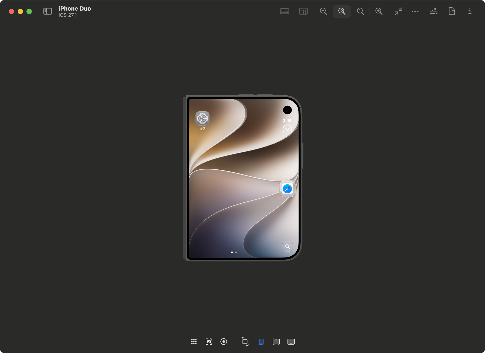
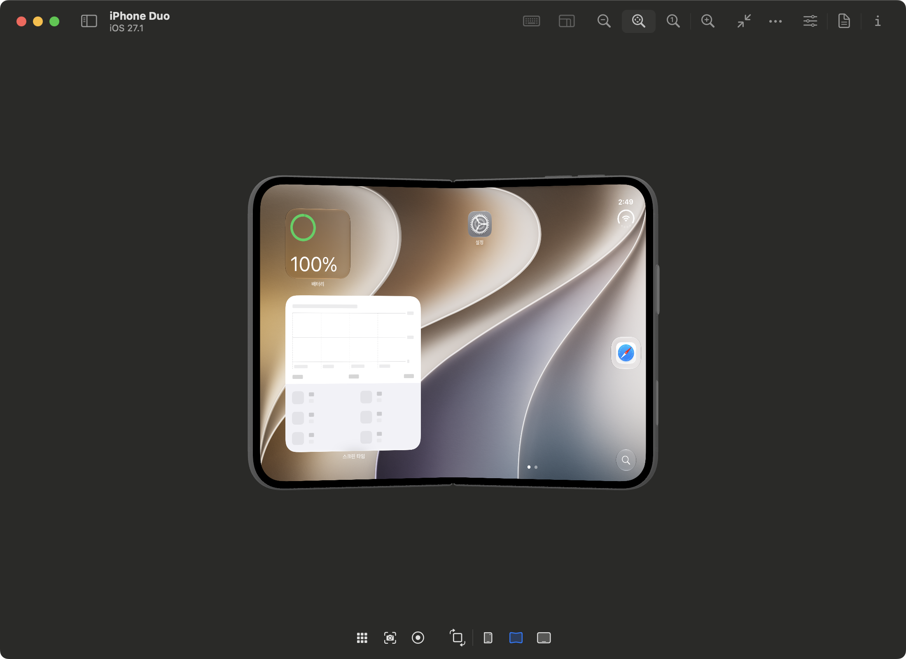

# iPhone Duo Simulator on macOS Sequoia

Build a separate copy of Device Hub from Xcode 27.1 to run the iPhone Duo simulator on macOS Sequoia. The build script adds compatibility libraries, patches the copied binaries, and signs the app locally.

Xcode 27.1 requires macOS Tahoe 26.6 or later. This is an unofficial compatibility patch. See [Apple's system requirements](https://developer.apple.com/xcode/system-requirements/).

## 1. Requirements

| Item | Version |
| --- | --- |
| Mac | Apple Silicon, running macOS natively |
| Source Xcode | Xcode 27.1, build `27A9275` |
| Compiler Xcode | Xcode 26.3, build `17C529` |
| Compiler | Apple Swift 6.2.3 or 6.2.4 |
| Simulator runtime | iOS 27.1, build `24A94232`, arm64 |
| Python | 3.9 or later |

Allow several tens of GB of free disk space. The runtime download is about 7.85 GB. Back up the Mac before installing shared developer components.

The instruction patches require the exact Xcode builds above. The builder checks the original binary hashes and instruction bytes before patching. Intel and Rosetta are not supported.

## 2. Files

```text
README.md                   Setup, test results, and patch details
LICENSE                     MIT license for original code
licenses/                   Third-party licenses and source credits
tools/build_devicehub.py     Build script
src/                        Compatibility sources
images/                     Simulator screenshots
```

Download Xcode and the simulator runtime from Apple. Apple binaries and build outputs are not included.

## 3. Prepare paths

Clone the repository:

```sh
git clone https://github.com/midworld/iphone-duo-simulator-sequoia.git
cd iphone-duo-simulator-sequoia
```

Run these commands from the source directory in zsh. Adjust the Xcode paths for your installation.

```sh
export DUO_XCODE='/Applications/Xcode-27.1.app'
export DUO_COMPILER_XCODE='/Applications/Xcode.app'
export DUO_RECIPE="$PWD"
export DUO_WORK="$HOME/Developer/Duo-Sequoia"
export DUO_OUTPUT="$DUO_WORK/build-01"
mkdir -p "$DUO_WORK"
python3 --version
sw_vers
uname -m
```

Each command selects its Xcode through `DEVELOPER_DIR`. The default `xcode-select` setting stays unchanged.

## 4. Download Xcode

Download the release `.xip` files from [Apple Developer Downloads](https://developer.apple.com/download/all/):

- Xcode 27.1, build `27A9275`
- Xcode 26.3, build `17C529`

An Apple account may be required. Keep the two apps side by side. Check the Apple signature before extracting each archive. For Xcode 27.1:

```sh
pkgutil --check-signature "$HOME/Downloads/Xcode_27.1.xip"
mkdir "$DUO_WORK/extract-27.1"
cd "$DUO_WORK/extract-27.1"
xip --expand "$HOME/Downloads/Xcode_27.1.xip"
codesign --verify --deep --strict ./Xcode.app
```

Move the extracted app to `/Applications/Xcode-27.1.app`. Keep Xcode 26.3 at the compiler path set above. Stop if either signature check fails.

Check the builds and compiler:

```sh
/usr/libexec/PlistBuddy -c 'Print :ProductBuildVersion' \
  "$DUO_XCODE/Contents/version.plist"
/usr/libexec/PlistBuddy -c 'Print :ProductBuildVersion' \
  "$DUO_COMPILER_XCODE/Contents/version.plist"
DEVELOPER_DIR="$DUO_COMPILER_XCODE/Contents/Developer" \
  /usr/bin/xcrun swiftc --version
```

The expected builds are `27A9275` and `17C529`. Device Hub, DeviceKit, and the Duo plugin are included in Xcode 27.1:

```text
Contents/Applications/DeviceHub.app
Contents/SharedFrameworks/DeviceKit.framework
Contents/SharedFrameworks/DeviceKit.framework/Versions/A/PlugIns/
  CoreDevicePopDeviceKitExtension.devicekitplugin
```

## 5. Install shared developer components

`xcodebuild -runFirstLaunch` updates shared files under `/Library`. Other Xcode installations use some of these files too. Make a system backup, then quit Xcode, Simulator, and Device Hub.

This additional archive saves the listed files with ownership, ACLs, extended attributes, and file flags. It excludes mounted runtimes, installer receipts, and service state. It supplements a system backup.

```sh
DUO_SHARED_BACKUP=$(mktemp -d "$DUO_WORK/shared-before-firstlaunch.XXXXXX")
typeset -a DUO_BACKUP_MEMBERS
DUO_BACKUP_MEMBERS=()
for DUO_MEMBER in \
  Library/Developer/PrivateFrameworks \
  Library/Developer/CoreSimulator/Profiles \
  Library/Developer/CoreDevice \
  Library/Developer/DeviceKit \
  Library/Developer/DeveloperDiskImages \
  Library/Apple
do
  [[ -e "/$DUO_MEMBER" ]] && DUO_BACKUP_MEMBERS+=("$DUO_MEMBER")
done
if (( ${#DUO_BACKUP_MEMBERS[@]} > 0 )); then
  sudo /usr/bin/tar --acls --xattrs --fflags -cpf \
    "$DUO_SHARED_BACKUP/shared-components.tar" -C / "${DUO_BACKUP_MEMBERS[@]}"
else
  print 'No paths found. Stop before installing shared components.'
fi
/usr/bin/tar -tf "$DUO_SHARED_BACKUP/shared-components.tar"
pkgutil --pkgs > "$DUO_SHARED_BACKUP/package-identifiers.txt"
```

Check the backup before continuing. Review the license, install the components, and check first-launch status:

```sh
sudo env DEVELOPER_DIR="$DUO_XCODE/Contents/Developer" \
  /usr/bin/xcodebuild -license
sudo env DEVELOPER_DIR="$DUO_XCODE/Contents/Developer" \
  /usr/bin/xcodebuild -runFirstLaunch
DEVELOPER_DIR="$DUO_XCODE/Contents/Developer" \
  /usr/bin/xcodebuild -checkFirstLaunchStatus
```

## 6. Install the iOS 27.1 runtime

```sh
DEVELOPER_DIR="$DUO_XCODE/Contents/Developer" \
  /usr/bin/xcodebuild -downloadPlatform iOS -buildVersion 27.1 \
  -architectureVariant arm64
DEVELOPER_DIR="$DUO_XCODE/Contents/Developer" \
  /usr/bin/xcrun simctl list runtimes
DEVELOPER_DIR="$DUO_XCODE/Contents/Developer" \
  /usr/bin/xcrun simctl list devicetypes
```

Check for iOS 27.1 / `24A94232` and `com.apple.CoreSimulator.SimDeviceType.iPhone-Duo`. A downloaded runtime DMG can also be installed with `xcodebuild -importPlatform '/path/to/runtime.dmg'`. See [Apple's component guide](https://developer.apple.com/documentation/xcode/downloading-and-installing-additional-xcode-components).

## 7. Build

Use a new output directory outside the source directory and both Xcode apps.

```sh
python3 "$DUO_RECIPE/tools/build_devicehub.py" \
  --xcode "$DUO_XCODE" \
  --compiler-xcode "$DUO_COMPILER_XCODE" \
  --output "$DUO_OUTPUT"
```

The builder copies Device Hub and DeviceKit, builds six compatibility libraries, patches the copies, and verifies their code signatures. It also checks that the original input binaries remain unchanged.

The output contains:

```text
DeviceHub-Duo.app
build-manifest.json
local-entitlements.plist
DevicesTrampoline.original
```

A failed build leaves its output for diagnosis. Use a new path for a retry:

```sh
export DUO_OUTPUT="$DUO_WORK/build-02"
```

The app loads some frameworks from the original Xcode path. Rebuild it after moving Xcode.

## 8. Run

Create and boot an iPhone Duo simulator:

```sh
DUO_UDID=$(DEVELOPER_DIR="$DUO_XCODE/Contents/Developer" \
  /usr/bin/xcrun simctl create 'iPhone Duo' \
  com.apple.CoreSimulator.SimDeviceType.iPhone-Duo \
  com.apple.CoreSimulator.SimRuntime.iOS-27-1)
print -r -- "$DUO_UDID"
DEVELOPER_DIR="$DUO_XCODE/Contents/Developer" \
  /usr/bin/xcrun simctl boot "$DUO_UDID"
DEVELOPER_DIR="$DUO_XCODE/Contents/Developer" \
  /usr/bin/xcrun simctl bootstatus "$DUO_UDID" -b
open "$DUO_OUTPUT/DeviceHub-Duo.app"
```

For an existing device, set `DUO_UDID` to its UUID and skip creation. Skip boot if it is already running.

Choose iPhone Duo in Device Hub and press Start if needed. Use Closed, Partially Open, Open, and the rotation controls. Allow boot and pose transitions to finish before testing input. Use one simulator frontend at a time.

To install and launch an app:

```sh
DEVELOPER_DIR="$DUO_XCODE/Contents/Developer" \
  /usr/bin/xcrun simctl install "$DUO_UDID" '/path/to/Simulator/MyApp.app'
DEVELOPER_DIR="$DUO_XCODE/Contents/Developer" \
  /usr/bin/xcrun simctl launch "$DUO_UDID" 'your.app.bundle.identifier'
```

Use a simulator build with a compatible minimum iOS version. A physical-device arm64 build cannot run in the simulator.

## 9. Test results

Build and runtime checks used an Apple M1 Max, macOS 15.7.7 / `24G720`, Swift 6.2.4, the macOS 26.2 SDK, and iOS 27.1 / `24A94232`.

| Check | Result |
| --- | --- |
| Build all six libraries from source | Passed |
| Verify signatures with `--verify --deep --strict` | Passed |
| Original Xcode input binaries unchanged | Passed |
| Closed, open, and partially open displays | Visible |
| Rotation and click input | Worked |
| Relaunch Device Hub without a debugger | Display returned |
| Safe-area layout, camera-area layout, and multitasking | No problem observed |
| Other simulator device types | No problem observed |

Swift uses Swift 5 language mode and library evolution. Actor-isolation warnings remain. C and Objective-C use `-Wall -Werror`.

These checks cover the local setup. A clean installation on another Mac, long-run stability, recording, physical-device connections, and camera capture have not been fully tested. Relaunch testing did not reset the simulator or reboot the Mac.






## 10. Troubleshooting

| Symptom | Check |
| --- | --- |
| Minimum macOS warning | Open the rebuilt app |
| Missing Observations symbol | Backport exports and DeviceKit patches |
| Booted device with a black screen | Shared components, runtime, task lifetime, and compositing |
| Outer display only, without fold controls | Duo plugin loading and the running app path |
| Incomplete image on the open display | Quartz adapter and app identifier |
| Missing framework in dyld output | Original Xcode path |
| Signature failure or immediate exit | Code signatures and crash reports |
| Hash or instruction mismatch | Exact Xcode build and unchanged input files |

Inspect the guest display separately from the 3D shell:

```sh
DEVELOPER_DIR="$DUO_XCODE/Contents/Developer" \
  /usr/bin/xcrun simctl io "$DUO_UDID" enumerate
DEVELOPER_DIR="$DUO_XCODE/Contents/Developer" \
  /usr/bin/xcrun simctl io "$DUO_UDID" screenshot --display=3 \
  "$DUO_WORK/inner-native.png"
```

Display 1 was the outer display and display 3 was the inner display in the test setup. Check the IDs with `enumerate`.

```sh
/usr/bin/log show --last 5m --style compact \
  --predicate 'process == "DeviceHub"'
open "$HOME/Library/Logs/DiagnosticReports"
```

Review logs before sharing them. They can contain local paths, device names, and app state.

## 11. Recovery

Quit Device Hub and remove the generated output directory. Simulator data is stored separately. Building the app leaves the original Xcode inputs and default `xcode-select` unchanged.

Removing the app does not roll back shared components installed by first launch. Use the previous Xcode's component installer or restore a system backup if those components cause a problem. Restoring only the file archive can leave services, receipts, or added files out of sync.

## 12. Patch details

The implementation is in [tools/build_devicehub.py](tools/build_devicehub.py) and [src/](src/). Offsets are file offsets in the original arm64e binaries.

### Input hashes

```text
DeviceHub.app/Contents/MacOS/DeviceHub
0a97f2c3ef3cc1b72feaf5561882ac7b86ed43d5399187c0f5bd0d78197f1f2b

DeviceKit.framework/Versions/A/DeviceKit
30de60c70b766c51d02d72c6fa6714abdc60b4de40e790359ec4c79243b2552e

CoreDevicePopDeviceKitExtension.devicekitplugin/Contents/MacOS/
CoreDevicePopDeviceKitExtension
d29e71b34571f30e5744b8337d6c195a22d254b40551cd17360ee47e2068ad55
```

Compiled compatibility libraries need the required ABI and exported symbols. Their bytes can differ between builds. The Apple input hashes must match because patches use fixed offsets.

### App layout and signing

The copied app uses `DeviceHub` as its executable and `local.devicehub.SequoiaCompat` as its identifier. `DevicesTrampoline` is moved outside the app, and the `devices://` URL handler is removed. App and plugin plist minimum-version entries use the build host version. Mach-O minimum OS entries stay unchanged.

The builder keeps `com.apple.security.*` entitlements except `com.apple.security.attestation.access`. Apple-only private capabilities and keychain groups are excluded. The sandbox and existing file/network exceptions remain. Library validation is disabled for the patched app.

Signing proceeds through libraries, plugin, framework, and app. Verification uses `--deep --strict`; signing does not use `--deep`.

### Compatibility libraries

| Library | Purpose |
| --- | --- |
| `libBackportObs.dylib` | Backport the Observations async sequence; reexport system Observation symbols |
| `libDuoFoundationCompat.dylib` | Route the Bundle dsoHandle initializer through its older fallback |
| `libDuoSwiftRuntimeCompat.dylib` | Provide `swift_coroFrameAlloc` and reexport Swift Core |
| `libDuoRealityCompat.dylib` | Adapt OpacityComponent and ConfigurationCatalog equality |
| `libDuoUI15.dylib` | Manage SwiftUI task modifier lifetime |
| `libDuoQuartzCompat.dylib` | Provide dynamic-range fallbacks and adjust screen compositing |

Swift libraries and the Swift runtime adapter use arm64e. The Quartz adapter uses arm64. Equal-length module names keep rewritten Mach-O string regions the same size.

Seven Observations imports in DeviceKit point to BackportObs. The `makeAsyncIterator` substitution changes `AC0E0V` to `AC0F0V`. The builder checks exports with `nm`. Cancellation uses the public actor-aware API; shared state uses an NSRecursiveLock-based `ManagedCriticalState`.

The SwiftUI adapter starts and cancels tasks on appearance, ID changes, and disappearance. It preserves actor isolation and priority. The new executor preference is not implemented. Only `_TaskValueModifier2` is redirected; the old frozen modifier remains bound to system SwiftUI. SwiftUI and RealityFoundation conformance descriptor aliases are required for plugin loading.

The Reality adapter uses the public RealityKit SDK module. Private identity and implicit animation behavior are not fully reproduced.

### DeviceKit instructions

These availability guards become NOP instructions (`1f2003d5`) to reach the backported Observations paths:

| Offset | Original bytes | Path |
| --- | --- | --- |
| `0x42D084` | `a00f0036` | HIDManager setup |
| `0x42DACC` | `e0120036` | HIDManager setup |
| `0x42DEA0` | `e0120036` | HIDManager async resume |
| `0x499F20` | `c0140036` | DeviceInteractionModel |
| `0x4A51E4` | `80140036` | Usage assertion |
| `0x4AD820` | `c0180036` | Interaction state |
| `0x4A96CC` | `a0130036` | Usage assertion early return |
| `0x4DFB6C` | `80080036` | Alternate DeviceStateTracker setup |
| `0x4E0028` | `60080036` | DeviceStateTracker setup |
| `0x585338` | `800d0036` | Accessibility observation |

The display tasks also need a longer wait. On the test host, `Task.sleep(nanoseconds: UInt64.max)` returned in about 0.0003 seconds and ended the display connection. Four arguments are changed to `Int64.max`, keeping cancellation intact:

```text
Offsets: 0x590AC0, 0x591214, 0x5A0B34, 0x5B7238
Before:  00008092
After:   0000f092
```

### Duo plugin

Two branches are changed so the task modifier initializer, metadata, and witness all select the backport type:

```text
0xB840: c0000034 -> 1f2003d5
0xB8CC: 80010034 -> 1f2003d5
```

The native 3D provider branch at `0xA4CFC` remains `55050014`.

### Screen compositing

On Sequoia, the display providers and screen transforms were present, but part of the framebuffer was hidden. Moving the screen host's parent layer forward made the full image visible. The internal renderer cause was not established.

The Quartz adapter hooks `NSView.viewDidMoveToSuperview`, calls the original implementation, and selects the `CoreDevicePopDeviceKitExtension.ScreenLayerHostView` class family. It sets the parent layer's `zPosition` to 100 after attachment and once more on the main queue. Existing views are scanned once. No periodic timer is used.

The hook runs in `local.devicehub.SequoiaCompat` on macOS major version 15. Meshes, framebuffer sizes, homography, screen positions, and input routing stay unchanged. Screen ordering can differ from native occlusion at overlapping 3D angles.

## 13. Xcode IDE reference

The builder targets Device Hub. These separate manual IDE patches also target Xcode 27.1 / `27A9275`:

```text
Contents/MacOS/Xcode SHA-256
c1536f3cf7163a8123d4220ae61bd1254ece53e5cb084193037d15ddbbb886ae

Contents/Frameworks/IDEKit.framework/Versions/A/IDEKit SHA-256
7971040964b16e5b0763c547de9ac5d2e0f215c415270b42d8da8b50842da682
```

| IDEKit offset | Before -> after | Purpose |
| --- | --- | --- |
| `0x374AA0` | `200b0034 -> 1f2003d5` | Welcome OS check |
| `0x6D7C40` | `40180036 -> 1f2003d5` | Initial editor OS assertion |
| `0xA5C05C` | `a00a0036 -> 1f2003d5` | Run/Stop toolbar assertion |
| `0x2B73C` | `f44fbea9 -> 10000014` | Template path for quick project creation |

The app's minimum OS plist entry was lowered. IDE XCStrings support and test plan editor frameworks were moved outside the app. IDEKit, ibtoold, and the app were ad-hoc signed with Apple-only entitlements excluded. The separate toolbar padding branch was kept.

A launcher used these process-local options after license review and first-launch setup:

```text
DVTEdgeOcclusionViewMode = Empty
IDEMostRecentPostFLEToolsVersion = 27.1
IDEDidCompleteThemesFLEToolsVersion = 27.1
IDEMostRecentPostFLEDate = actual completion date
IDELanguageModelSelectedDuringFirstLaunch = 1
IDEMetalToolchainSelectedDuringFirstLaunch = 1
IDEFirstLaunchSuppressPlatformChooser = YES
```

It set `CFFIXED_USER_HOME`, `DEVELOPER_DIR`, and `TOOLCHAINS`. Welcome, SwiftUI, Intelligence, and editor compatibility issues remain. IDE patching is not automated by this project.

## 14. License

Original code is licensed under [MIT](LICENSE), copyright 2026 Midworld Kim.

The Observation backport includes code from Swift and ObservationsKit under Apache 2.0 with the Swift Runtime Library Exception and BSD 3-Clause. Those licenses and copyright notices remain in effect. See [third-party licenses and credits](licenses/README.md) for the file mapping.

Xcode, Apple SDKs, and simulator runtimes are distributed by Apple under their own terms.

## References

- [Apple Xcode requirements](https://developer.apple.com/xcode/system-requirements/)
- [Xcode 27.1 release](https://developer.apple.com/news/releases/?id=10152026a)
- [Xcode 27.0 on Sequoia reference](https://gist.github.com/MihaelIsaev/b09f16a1e8400624d57f539fadcc8a59) — targets `27A266a`; 27.1 offsets differ
- [ObservationsKit](https://github.com/Archdoog/ObservationsKit)
- [Swift project](https://github.com/swiftlang/swift)
- [Swift runtime Heap.cpp](https://github.com/swiftlang/swift/blob/main/stdlib/public/runtime/Heap.cpp)
